# Flujos de negocio por módulo: requisitos y código actual

**Sistema:** Gestión Administrativa del Laboratorio de Metrología USC
**Base de requisitos:** `Requerimientos_Metrologia_v6_revision_codigo.xlsx` (v6 y RF-47 a RF-50 añadidos en la revisión)
**Tipo de revisión:** lectura estática del Excel y del repositorio; no es una prueba de aceptación.

## Cómo leer los diagramas

En cada módulo se presentan dos flujos paralelos:

- **Flujo definido por requisitos:** interpretación del proceso esperado en el Excel.
- **Flujo observado en código:** lo que hacen hoy las pantallas, rutas y servicios localizados. Un paso faltante o diferente es una brecha; el diagrama no implica que el requisito esté satisfecho.

Los diagramas muestran decisiones de negocio y no cada llamada técnica. Los módulos de clientes, usuarios, administración, informes, cotizaciones, OT, recepción, calibración/revisión, firma/certificación, envío y reportes están agrupados en nueve secciones para facilitar la comparación.

## 1. Gestión de clientes (RF-01 a RF-04, RF-40)

### Flujo definido por requisitos

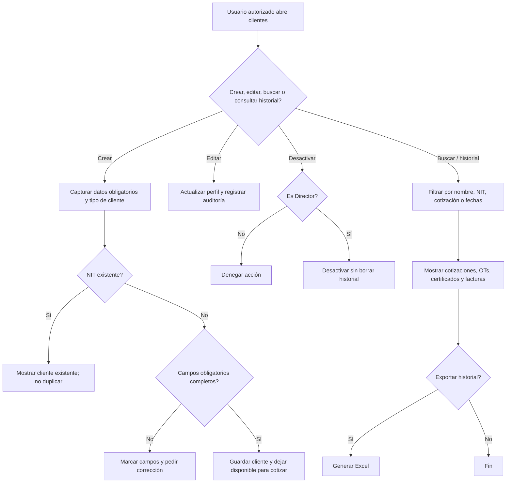

### Flujo observado en código

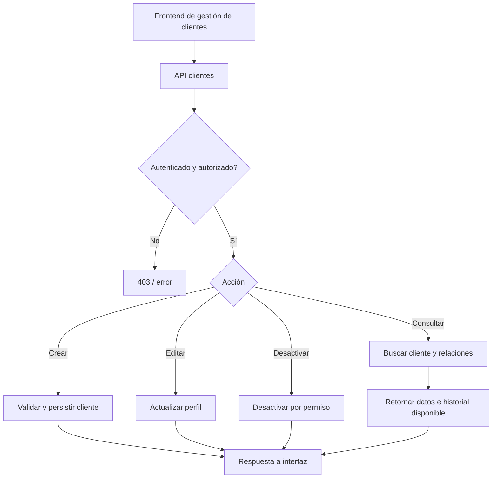

**Diferencia a validar:** los requisitos fijan roles y filtros detallados; el permiso real depende de la configuración de roles activa. La matriz, el seed y el texto de RF-02/RF-04 no coinciden completamente. La exportación completa del historial y sus filtros requieren validación funcional.

## 2. Gestión de cotizaciones (RF-05 a RF-12, RF-44 y RF-45; RF-IA-01 y RF-IA-06)

### Flujo definido por requisitos

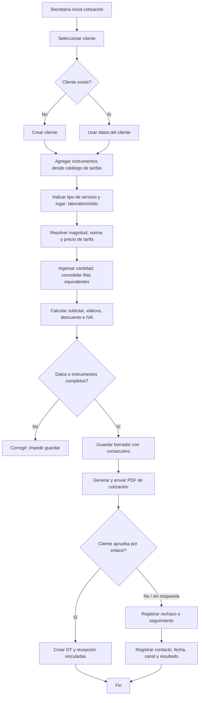

### Flujo observado en código

```mermaid
flowchart TD
 A[Frontend cotización] --> B[API valida permisos y filas duplicadas]
 B --> C{Cliente y detalles recibidos?}
 C -->|No| D[Rechazar petición]
 C -->|Sí| E[Asignar consecutivo y persistir encabezado/detalles]
 E --> F[Calcular valores enviados por frontend/API]
 F --> G[Encolar documento/correo según acción]
 G --> H{Respuesta del cliente por enlace firmado?}
 H -->|No| I[Cron actualiza vencimiento/seguimiento según parámetros]
 H -->|Sí| J[Marcar aprobada y generar OT(s) y recepción(es)]
 I --> K[Consultar / editar]
 J --> K
 K --> L{OT asociada en estado protegido?}
 L -->|Sí| M[Bloquear edición de cotización]
 L -->|No| N[Editar detalles y sincronizar OT/recepción]
```

**Diferencias:** la aprobación efectiva se realiza por enlace del cliente; el cambio interno de estado no es el flujo principal. La creación de OT también está descrita en RF-13. El correo institucional y la respuesta real de entrega dependen de la configuración externa. El cotizador de IA es un widget demostrativo, no un asesor conectado al backend.

## 3. Órdenes de trabajo (RF-13 a RF-17; RF-IA-04 y RF-IA-07)

### Flujo definido por requisitos

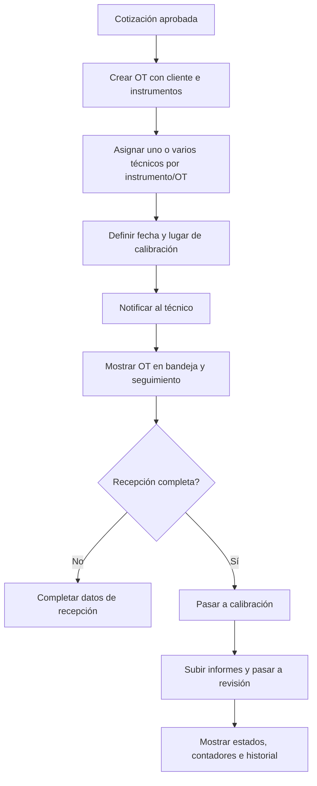

### Flujo observado en código

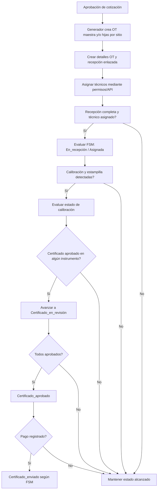

**Diferencias:** la FSM avanza de forma monotónica y el criterio observado para `Certificado_en_revisión` es que exista un certificado aprobado; el requisito espera que la carga completa de informes inicie revisión. El permiso para asignar y ver la bandeja cambia entre matriz y seed. La cardinalidad de técnico compartido por instrumento no está definida.

## 4. Recepción de equipos (RF-18 a RF-20, RF-49; flujo relacionado RF-47 y RF-48)

### Flujo definido por requisitos

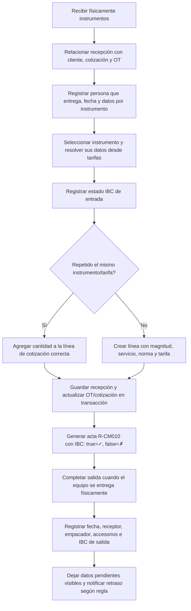

### Flujo observado en código

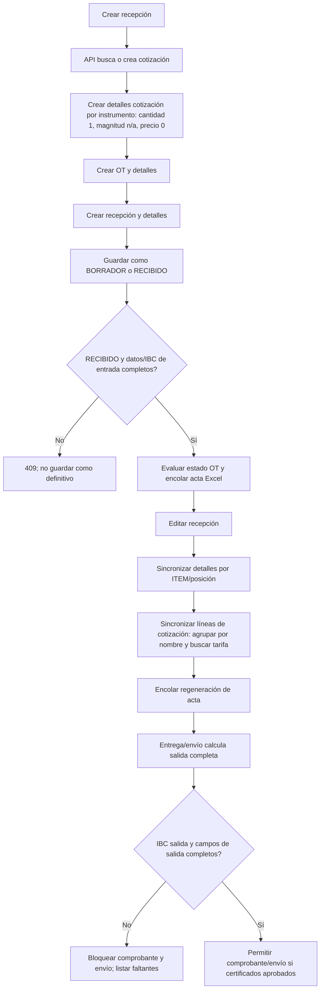

**Diferencia clave:** la creación inicial no usa la sincronización por tarifas; la sincronización de cotización por tarifa ocurre en actualización. Además, la API de envío usa la salida física como condición previa de pago/comprobante y correo de certificados. Esto mezcla dos hechos distintos: que el laboratorio finalizó y notificó el certificado, y que el cliente recogió físicamente los instrumentos.

## 5. Calibración e informes (RF-21 a RF-23, RF-50; RF-IA-02 y RF-IA-03)

### Flujo definido por requisitos

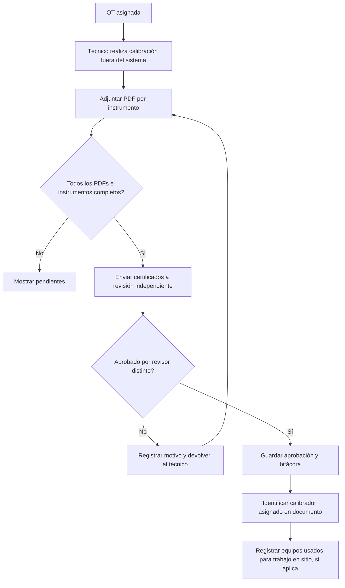

### Flujo observado en código

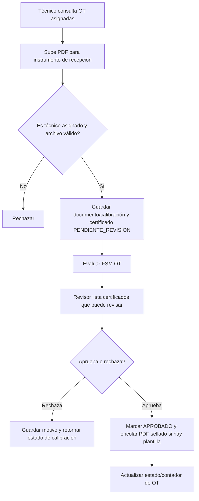

**Diferencias:** la ruta de lista filtra el propio certificado del técnico, pero las mutaciones de aprobar/rechazar deben aplicar el mismo control en servidor. El nombre del técnico en el campo “calibró” no se completa de forma comprobada por instrumento. No se identificó el flujo requerido de IA/análisis de anomalías. La bitácora de equipos usados en sitio requiere verificar acceso y alcance de visibilidad.

## 6. Firma, sello y certificación (RF-24 a RF-28)

### Flujo definido por requisitos

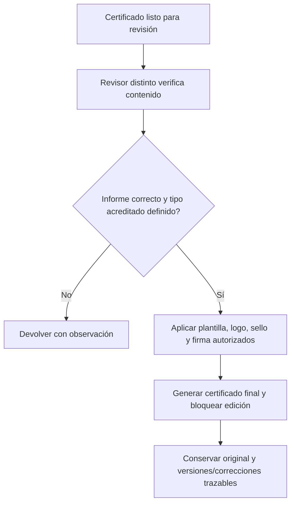

### Flujo observado en código

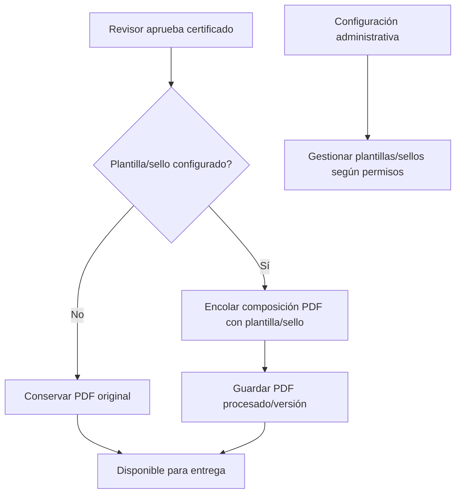

**Diferencia:** composición visual de PDF y sello no equivale por sí sola a firma digital criptográfica verificable. La inmutabilidad, la firma electrónica y la regla de corrección deben definirse y comprobarse de manera diferenciada.

## 7. Entrega y envío (RF-29 a RF-31, RF-47 y RF-48)

### Flujo definido por requisitos

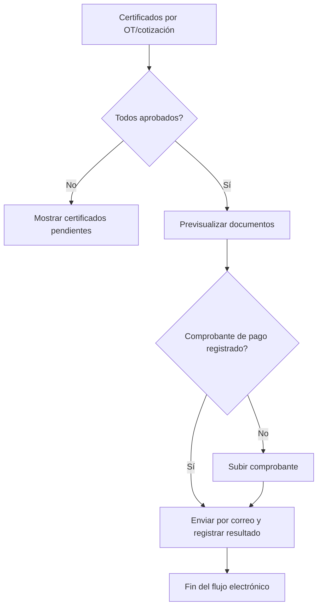

### Flujo observado en código

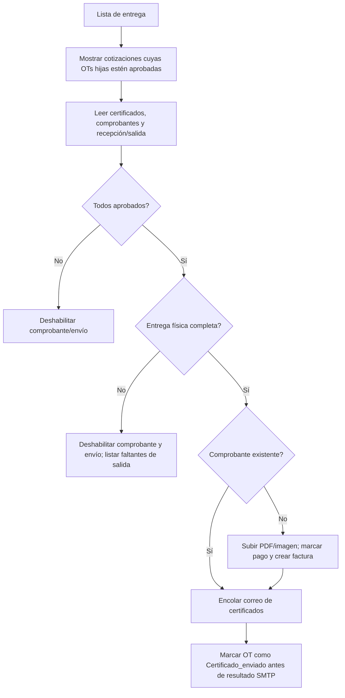

**Discordancia de negocio:** el bloqueo actual impide enviar certificados antes de diligenciar la salida física. Si el proceso del laboratorio permite notificar primero y que el cliente recoja después, este gate genera bloqueos artificiales. Recomendación: conservar como obligatorios los controles técnicos y económicos de envío —todos los certificados aprobados, comprobante/pago según la política acordada y correo válido—; llevar la entrega física a un estado independiente `Pendiente de retiro / Entregado`, que puede completarse después. Si el laboratorio quiere dejar el comprobante registrado antes del pago real, debe definirse como “comprobante recibido/en validación”, sin marcar automáticamente `PAGADO`.

**Otro riesgo:** al encolar el correo, la OT se marca `Certificado_enviado` antes de confirmar resultado. Se recomienda estados separados `En cola`, `Enviado`, `Fallido` y `Reintento`, con auditoría del worker.

## 8. Reportes y consolidados (RF-32 a RF-35, RF-41 y RF-46; RF-IA-05 y RF-IA-08 a RF-IA-10)

### Flujo definido por requisitos

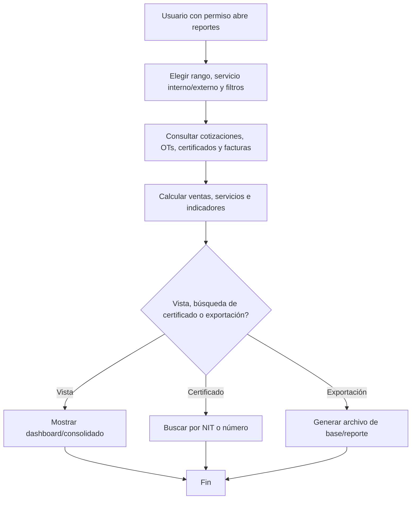

### Flujo observado en código

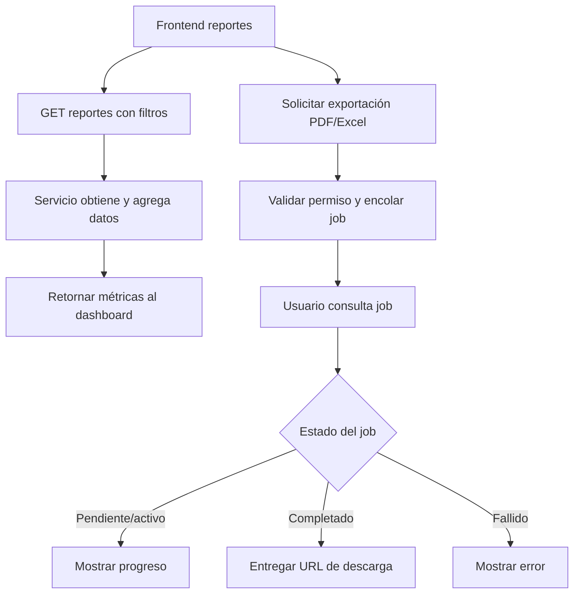

**Diferencias:** no todos los criterios de trazabilidad factura↔OT↔certificados, búsqueda y exportación están demostrados por el endpoint general; deben validarse en datos representativos. Las funciones narrativas/predictivas de IA no están conectadas.

## 9. Administración del sistema (RF-36 a RF-39, RF-42 y RF-43)

### Flujo definido por requisitos

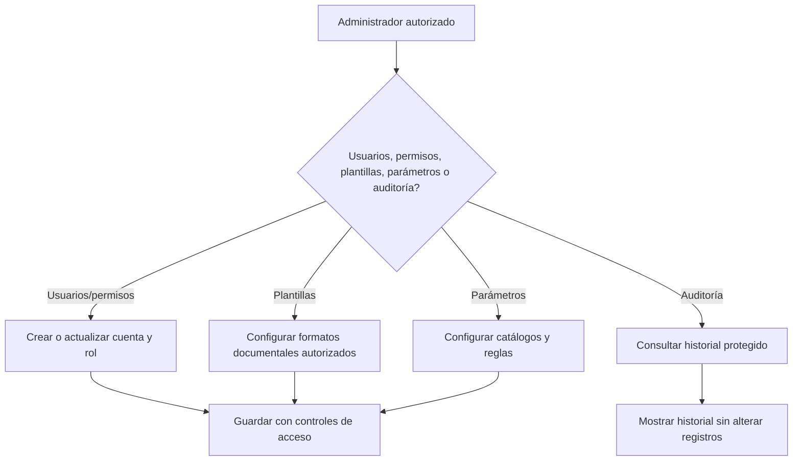

### Flujo observado en código

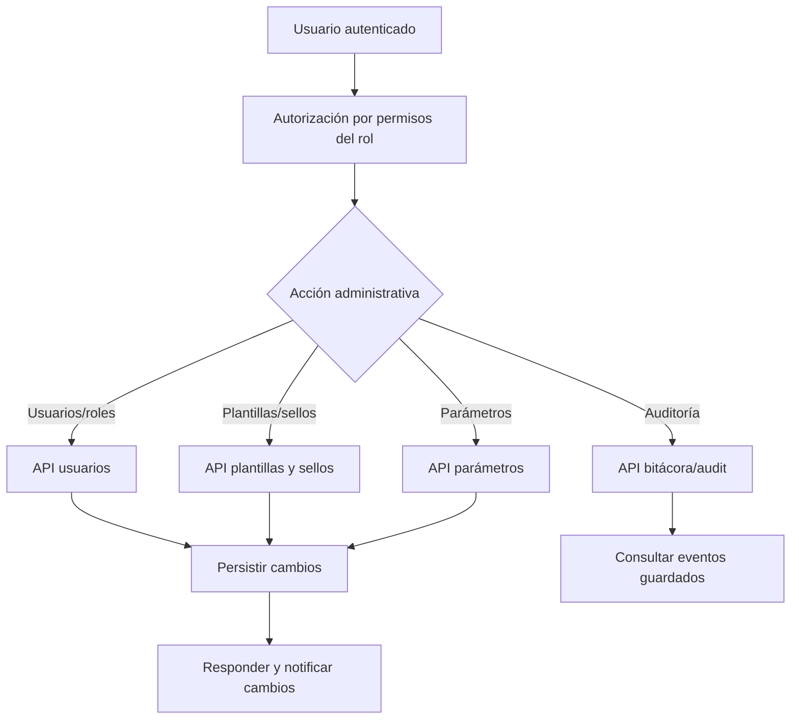

**Diferencias:** la asignación de permisos para plantillas, logos y sellos no es uniforme entre matriz, seed e interfaz. Los RF-42/RF-43 dependen del despliegue/arquitectura y no se prueban con la mera existencia de una pantalla.

## 10. Inteligencia artificial (RF-IA-01 a RF-IA-10 y RNF-IA)

### Flujo definido por requisitos

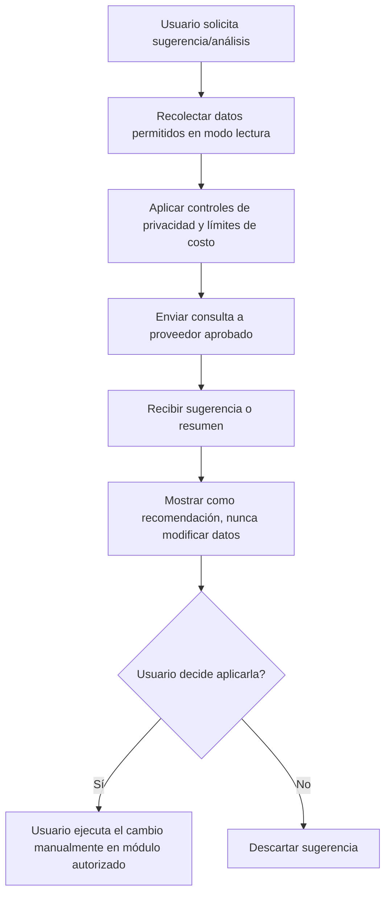

### Flujo observado en código

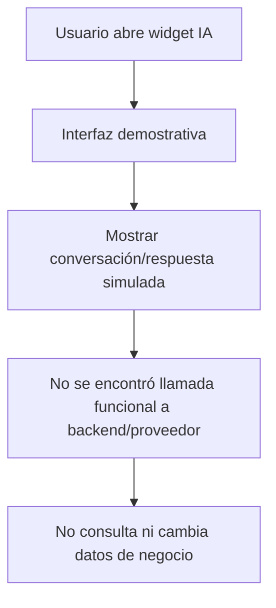

**Diferencia:** los requisitos de IA son alcance adicional sin servicio de IA integrado. Además, el Excel menciona herramientas de NestJS aunque la API del proyecto está construida con Fastify. Tratar como fase futura hasta decidir proveedor, privacidad, controles, presupuesto e integración.

## Revisión especial: altas, cambios y bajas de instrumentos en recepción

### Qué ocurre hoy

1. **Nueva recepción independiente:** la ruta crea la cotización si hace falta y agrega una línea por instrumento con `CANTIDAD=1`, `MAGNITUD='n/a'`, `VALOR_UNITARIO=0` y total cero. No consulta `tarifas` ni agrupa nombres repetidos en esta ruta.
2. **Selector de instrumento:** el datalist muestra como valor una etiqueta compuesta (`magnitud - tipo de servicio (instrumento)`). Al seleccionarla, ese texto puede quedar guardado como `instrumento`, en vez del nombre canónico. Esto dificulta o impide la búsqueda correcta en tarifas.
3. **Edición de recepción:** se llama a `sincronizarCotizacionDesdeRecepcion`. Este agrupa por el texto de nombre exacto y reconstruye una línea por nombre, pero busca tarifa por nombre exacto y luego por prefijo. Si no resuelve, acepta magnitud `n/a` y precio cero. Las líneas existentes se buscan por nombre sin restringir tipo de servicio ni sitio, y puede reutilizar precio/magnitud/norma de otra combinación.
4. **Edición con sitio cambiado:** la sincronización recibe el sitio anterior guardado (`actual.SITIO_CALIBRACION`), no necesariamente el nuevo valor enviado en el formulario.
5. **Eliminar instrumento:** el endpoint hace soft-delete de recepción y de un detalle OT seleccionado por `ITEM` o nombre; sincroniza cotización y conserva registro histórico. El emparejamiento por nombre/posición puede ser ambiguo si existen instrumentos duplicados del mismo tipo.
6. **Modificar instrumento:** la actualización empareja primero por `ITEM`/posición. Cambiar el nombre, serie o datos de una fila puede actualizar el mismo registro al que ya se relaciona una calibración/certificado; no se observó bloqueo por certificado existente. Esto puede alterar la identidad que se muestra en un documento histórico.
7. **Bloqueos de edición:** la API de cotizaciones sí verifica estados protegidos de sus OTs; los endpoints `PUT /recepciones/:id`, soft-delete de instrumento y soft-delete de recepción no hacen una validación equivalente del estado de la OT. Por ello, la restricción visual de campos raíz no protege las operaciones directas de instrumentos ni el API.
8. **Versionado:** cada actualización de recepción genera consecutivo de versión aun cuando cambien datos menores; la modificación de datos de recepción por sí sola no cambia el consecutivo OT salvo cambios de instrumentos detectados. El versionado debería distinguir cambio documental, cambio de identidad y corrección administrativa.

### Qué debería ocurrir

- Identificar la tarifa por una clave estable (`ID_TARIFA`) y mantener separados **instrumento**, **magnitud**, **tipo de servicio**, **norma**, **sitio** y **precio cotizado**. No usar una etiqueta visual como valor persistido.
- Al aceptar un instrumento, resolver exactamente una tarifa vigente. Si hay cero o más de una coincidencia válida, mostrar error y pedir selección explícita; no guardar silencio con tarifa cero o prefijo ambiguo.
- Agrupar solo cuando coincidan los atributos comerciales (tarifa/tipo de servicio/sitio y, según regla, misma clase/modelo). Mantener además una fila por instrumento físico en recepción/OT, porque cada número de serie y certificado es individual. La cantidad de cotización es la suma de esos instrumentos.
- Hacer creación/actualización de recepción, cotización y OT en una transacción. Antes de confirmar, comparar el número de instrumentos por categoría y avisar el precio/total recalculado. No alterar cotizaciones ya enviadas/aprobadas sin una nueva versión y aprobación del cliente.
- Permitir cambios de datos logísticos mientras la OT está en estados iniciales, con auditoría. Bloquear cambio de identidad, tipo de servicio, tarifa/cantidad y eliminación de instrumentos desde que haya asignación/calibración iniciada (`En_calibración` o posterior), certificado generado o envío. Excepción administrativa: crear corrección/versionado y conservar intacto el certificado anterior.
- Alinear validación en frontend y backend. El backend debe ser autoridad; comprobar el estado de OT de forma transaccional en `PUT`, baja de instrumento y baja de recepción. No confiar en controles deshabilitados de pantalla.
- Para retirada física después de enviar certificados, registrar la salida posteriormente como un evento independiente. El certificado puede enviarse cuando esté aprobado y se cumpla la política de pago; la recepción física puede permanecer `Pendiente de retiro`.

### Matriz recomendada de qué se permite por etapa

| Etapa de la OT | Corregir datos logísticos de recepción | Agregar instrumento | Cambiar instrumento/servicio | Eliminar instrumento |
|---|---:|---:|---:|---:|
| `Creada` / antes de iniciar calibración | Sí, con historial | Sí, recalculando cotización/OT | Sí, con tarifa explícita y versión | Sí, baja lógica y ajuste comercial |
| `En_recepción` / `Asignada`, aún sin calibración ni certificado | Sí, con auditoría | Solo con autorización y revalidar asignación/cantidad | Solo si se invalida/reasigna el trabajo y queda versionado | Solo con autorización; retirar asignación y ajustar cotización |
| `En_calibración` o posterior | Solo campos no técnicos y sin cambiar el documento cerrado | No en la misma OT; usar modificación formal/OT adicional | No; corrección formal que conserva el original | No; anular/corregir con aprobación y trazabilidad |
| Certificado enviado | Corregir únicamente datos de contacto/logística sin reescribir certificado | No | No | No; emitir corrección/revocación según política documental |

La etapa de OT no siempre describe el estado real de cada instrumento, porque el trabajo puede estar distribuido. Para decisiones definitivas, conviene validar por **instrumento** la existencia de asignación, calibración y certificado, y por OT el bloqueo general.

## Recomendación de negocio para el conflicto entrega física vs. envío digital

El comportamiento actual exige diligenciar la salida física antes de subir el comprobante y enviar los certificados. Eso no representa el caso que describe el área: el certificado puede remitirse cuando el cliente aún no ha recogido sus instrumentos.

Se recomienda separar dos procesos:

1. **Cierre técnico y envío digital:** todos los certificados aprobados → comprobar pago según política institucional → enviar certificados → registrar resultado real del correo.
2. **Entrega física:** cuando el cliente recoge → registrar fecha/hora, quién entrega y recibe, accesorios, IBC de salida y estado de retiro. Antes de ese momento mostrar `Pendiente de retiro`, sin bloquear el envío digital.

La excepción es una regla contractual o de seguridad explícita que prohíba liberar documentos hasta registrar salida. Si esa regla existe, debe decir “prohibido enviar antes de la entrega física” y el laboratorio debe confirmar que corresponde a su proceso. De lo contrario, `RF-47` no debe ser condición del correo: mantenerlo como requisito para cerrar la entrega física. También es necesario distinguir “comprobante cargado”, “pago validado” y “pago realizado”; actualmente subir el archivo marca la OT como `PAGADO`.

## Archivos y evidencia revisada

- Excel revisado: `outputs/revision_metrologia_v6/Requerimientos_Metrologia_v6_revision_codigo.xlsx`, hojas `RF - Req. Funcionales`, `Matriz de Roles`, `Coherencia de negocio`.
- Recepción y sincronización: `Backend/src/routes/recepciones.routes.ts`, `Backend/src/services/cotizacion-sync.service.ts`, `Frontend/app/dashboard/module/recepciones.tsx`.
- Estados y envío: `Backend/src/services/ot-fsm.service.ts`, `Backend/src/routes/envios.routes.ts`, `Frontend/app/dashboard/module/Envio_entrega.tsx`.
- Cotización/OT: `Backend/src/routes/cotizaciones.routes.ts`, `Backend/src/services/cotizacion-aprobacion.service.ts`, `Backend/src/services/ot-split.service.ts`.
- Calibración, revisión, reportes y administración: rutas y pantallas correspondientes bajo `Backend/src/routes/` y `Frontend/app/dashboard/module/`.

**Alcance de la conclusión:** diagramas basados en texto de requisitos y lectura del código. No se ejecutaron pruebas de interfaz, API, base de datos, correo ni despliegue; los comportamientos señalados deben confirmarse en un entorno de prueba antes de liberar cambios.
